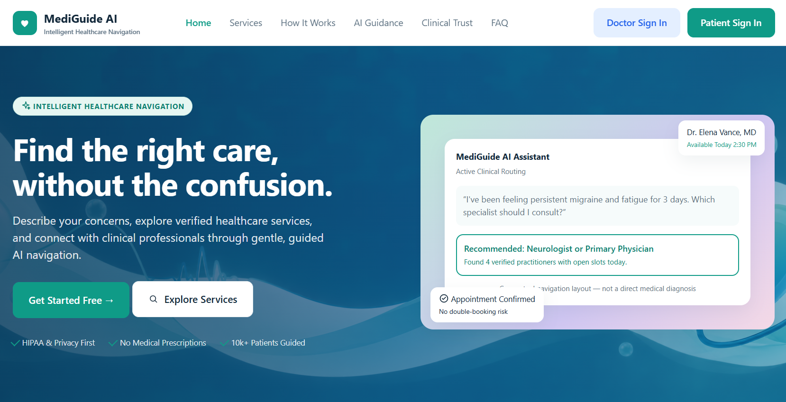
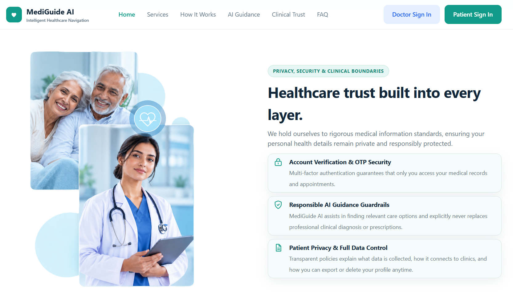
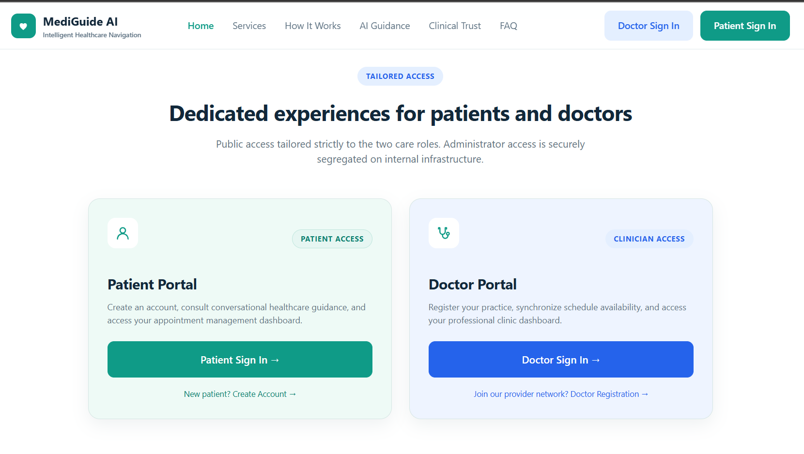

<div align="center">

# 🩺 MediGuide AI

**A role-based healthcare navigation platform with secure onboarding, OTP verification, and an admin-controlled doctor approval workflow.**


</div>

---

## 🎯 About

MediGuide AI helps patients find the right care and gives clinicians a verified place on the platform. I built the full foundation end to end: database design, authentication and authorization, server-rendered UI, admin tooling, and automated tests.

## ✨ Highlights

- **Three-role system**: separate patient, doctor, and admin portals with role-based access control
- **Email OTP verification**: 6-digit codes, hashed at rest, expiring in 10 minutes, with resend
- **Doctor approval workflow**: doctors can register, but cannot sign in until an admin approves them
- **Admin dashboard**: search, paginate, edit, approve, and delete accounts
- **Secure password reset**: token-based, and scoped so a reset link only works for the right portal
- **Tested**: feature tests covering the approval and password-reset flows

## 🛠 Tech Stack

| Area | Tools |
| --- | --- |
| Backend | PHP 8.3, Laravel 13, Eloquent ORM |
| Database | MySQL (SQLite for quick local setup) |
| Frontend | Blade templates, custom responsive CSS |
| Auth | Session auth, custom role middleware, bcrypt hashing |
| Testing | PHPUnit 12 |
| Tooling | Composer, Laravel Pint, Artisan |

## 🔐 Engineering Highlights

- Role-gated middleware returning `403` for unauthorized access
- Session regeneration on login and full invalidation on logout
- Hashed OTPs and hidden sensitive model attributes
- Portal-scoped authentication so credentials from one portal never work in another
- Server-side validation on every form, with admin accounts protected from edit and delete

## 🚀 Quick Start

```bash
git clone <your-repo-url> && cd mediguide
composer install
cp .env.example .env && php artisan key:generate
# configure DB_* in .env (or use SQLite)
php artisan migrate --seed
php artisan serve
```

Open **http://localhost:8000**. Run the tests with `php artisan test`.

## 📸 Screenshots








## 🗺 Roadmap

- [ ] Doctor directory and specialty search
- [ ] Appointment booking with conflict prevention
- [ ] Diagnostic tests and labs catalogue
- [ ] AI care guide for symptom-to-specialty navigation
- [ ] Rate limiting, audit logging, CI pipeline

## 👤 Author

**Md Jillur Rahman**
[LinkedIn](https://linkedin.com/in/md-jillur-rahm) · [GitHub](https://github.com/capJillur) · jrrahman0322@gmail.com

## 📄 License

Released under the [MIT License](https://opensource.org/licenses/MIT).